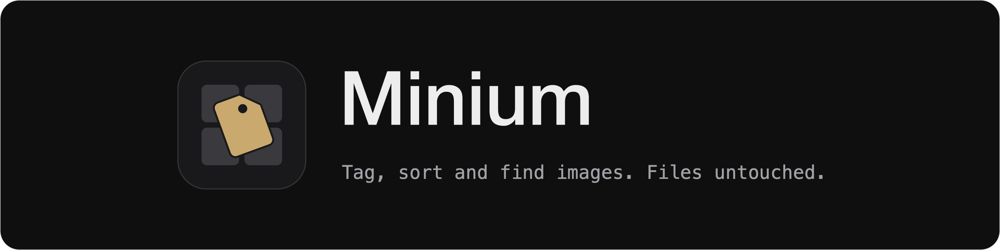
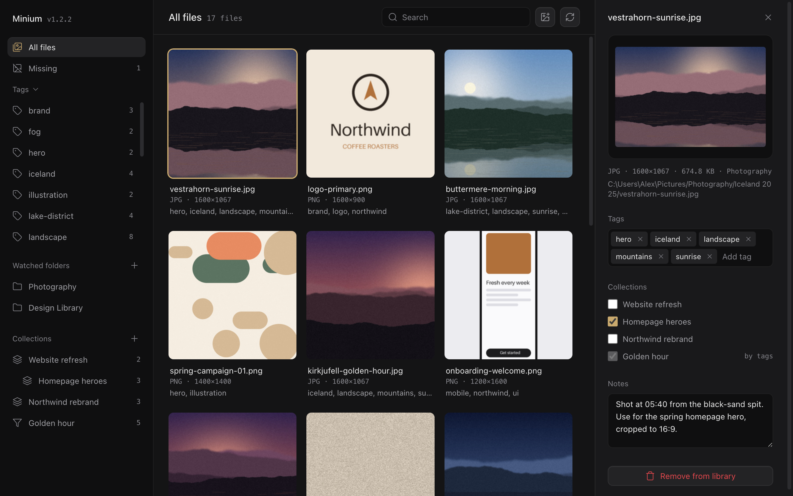
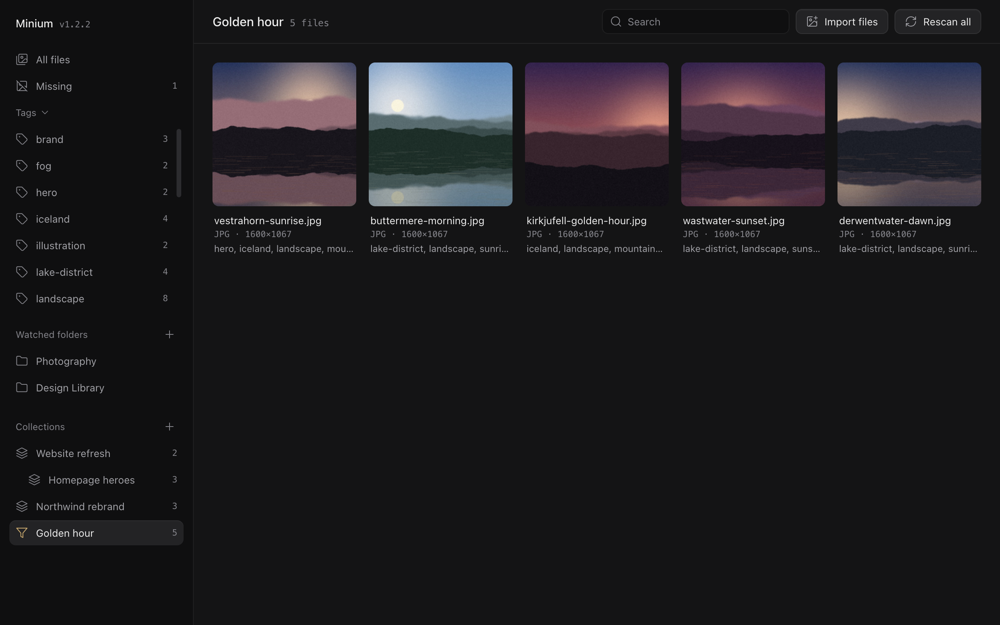
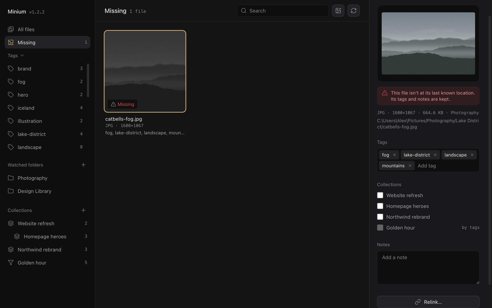

Minium is a desktop app for Windows, macOS and Linux. It adds **tags, notes and collections** to the image folders you already use. It never moves, renames or changes your files.

Add your folders and Minium builds a searchable library on top of them. The library is kept in the app's own data folder. Your folders stay as they are.

Works offline. No account, no tracking. The app goes online only when you check for updates.

**Note:** Minium was called Asset Manager before. Your library carries over. See [Updating to a New Version](#updating-to-a-new-version).

<picture>
  
</picture>

## Download and Install

Download the latest build from the [Releases page](https://github.com/TariqMK/Minium/releases/latest). The app needs no installer.

| Platform | Download | Open |
| --- | --- | --- |
| Windows 10 / 11 (x64) | `Minium-vX.Y.Z-windows-x64.zip` | `Minium\Minium.exe` |
| macOS (Apple Silicon) | `Minium-vX.Y.Z-macos-arm64.zip` | `Minium.app` |
| Linux (x64) | `Minium-vX.Y.Z-linux-x64.tar.gz` | `Minium/Minium` |

### Windows

1. Download `Minium-vX.Y.Z-windows-x64.zip`.
2. Extract the zip to a folder you can write to, for example `Documents`. Do not use `Program Files`, because the app saves your library next to itself.
3. Open the `Minium` folder and run `Minium.exe`.

**Note:** The app is not code-signed. The first time, Windows SmartScreen can show *Windows protected your PC*. Select **More info**, then **Run anyway**.

- Keep the `Minium` folder together. `Minium.exe` needs the `_internal` folder next to it. To start it from the Start menu or the desktop, make a shortcut to `Minium.exe`.
- The window needs the Microsoft Edge WebView2 runtime. Windows 11 and an up-to-date Windows 10 include it.

### macOS

**Note:** The app is not signed with an Apple Developer certificate. macOS blocks it the first time you open it. Steps 3 to 5 approve it once.

1. Download `Minium-vX.Y.Z-macos-arm64.zip` and open it.
2. Move `Minium.app` to `Applications`.
3. Open `Minium.app`. macOS shows that it cannot open the app. Select **Done**.
4. Open **System Settings** > **Privacy & Security**.
5. Scroll to **Security**, select **Open Anyway** next to Minium, and confirm.

Your library is stored outside the app. Moving or replacing `Minium.app` does not change it.

### Linux

1. Download `Minium-vX.Y.Z-linux-x64.tar.gz`.
2. Extract it to a folder you can write to.
3. Run `Minium/Minium`.

Keep the `Minium` folder together. The app saves your library next to itself.

## Getting Started

1. Open Minium and select **Add a folder**.
2. Select a folder of images.
3. Choose whether to include its subfolders, then confirm. The scan runs in the background. Progress shows in the bottom-right corner.
4. Select an image to open its details panel.
5. Add tags and notes, and tick the collections it belongs to.

Minium only reads your images to make previews. It does not move or change any file.

**Supported formats:** PNG, JPG/JPEG, GIF, WebP, BMP, TIFF and SVG.

**Note:** SVG files can be tagged, but they show a placeholder instead of a preview.

## Features

- **Files untouched.** Minium never moves, renames, edits or deletes your files. **Remove from library** removes only Minium's record of a file.
- **Watched folders.** Add any folder on a local disk, an external drive or a network share, with or without its subfolders. Rescan at any time to find new files.
- **Import files.** Drag images onto the window, or select **Import files**, to add files outside your watched folders.
- **Tags and notes.** Tag any image and add free-text notes. Each tag in the sidebar shows its file count. Select a tag to filter by it.
- **Collections.** Put files in a tree of collections and sub-collections. Collections do not depend on where a file is on disk. One file can be in many collections.
  - **Manual** collections hold the files you add.
  - **Smart** collections hold every file that matches their tag rules. A rule matches *any* or *all* of its tags. Several rules combine with *and* or *or*. The collection updates as you tag.
- **Search** by file name, tag or note text.
- **Missing files.** A file that is no longer at its last location shows under **Missing**. Its tags, notes and collections are kept. **Relink…** points it at its new location.
- **Offline drives.** A watched folder that cannot be reached, for example on an unplugged drive, shows as *offline* in the sidebar. Its files are not marked missing.

### Screenshots

A smart collection. It holds every landscape tagged *sunrise* or *sunset*, and it updates as you tag.

<picture>
  
</picture>

The **Missing** view. A file moved outside the app keeps its tags and notes. **Relink…** points it at the new location.

<picture>
  
</picture>

## Privacy

- **Works offline.** Every feature except **Check for updates** works with no internet connection.
- **No tracking.** The app has no telemetry, analytics, crash reporting or account.
- **Your data stays on your computer.** Tags, notes, collections and previews are stored in the `library_data` folder. See [Where Your Library Is Stored](#where-your-library-is-stored). Your images are only read. They are never uploaded.
- **One network connection, only when you ask.** When you select the version number, the app asks GitHub (`api.github.com`) for the latest release. It sends nothing else. It downloads nothing.

## Using Minium

| Task | Steps |
| --- | --- |
| Add a folder | Select **+** next to *Watched folders*. Select a folder and choose whether to include subfolders |
| Import images | Drag them onto the window, or select **Import files** |
| Find new or changed files | Select **Rescan all**. To rescan one folder, point to it in the sidebar and select **Rescan** |
| Stop watching a folder | Point to it in the sidebar and select **Stop watching**. The files on disk do not change. Their tags and notes are removed from the library |
| Tag or annotate an image | Select the image. Add tags and notes in the details panel |
| Filter by tag | Select a tag in the sidebar. To clear it, select **×** next to the view title |
| Create a collection | Select **+** next to *Collections*. Choose **Manual** or **Smart** |
| Add a sub-collection, rename or delete | Point to the collection in the sidebar and use its buttons |
| Add an image to a collection | Select the image. Tick the collection in the details panel |
| Relink a moved file | Select **Missing** in the sidebar. Select the file, then select **Relink…** |
| Stop tracking a file | Select **Remove from library** in the details panel. The file on disk does not change |
| Close the details panel | Select **×** or press **Esc** |

### Check for Updates

The app never checks for updates by itself. To check:

1. Select the version number next to *Minium* at the top of the sidebar. It shows *checking…* while it waits.
2. Read the result in the **Check for updates** dialog.
3. If a newer version is available, select **Open release page**. The release page opens in your browser.
4. Download the new version. Follow [Updating to a New Version](#updating-to-a-new-version).

**Note:** After a newer version is found, the version number stays gold until you close the app.

## Where Your Library Is Stored

Your tags, notes, collections and previews are stored in a `library_data` folder:

- **Windows and Linux:** in the `Minium` folder, next to the app.
- **macOS:** `~/Library/Application Support/Minium/library_data`.

**Note:** If you used the app when it was called Asset Manager, your Mac library stays in `~/Library/Application Support/AssetManager/library_data`. Minium finds it and keeps using it.

```
library_data/
├── library.json        # watched folders and settings
├── collections.json    # your collection tree
├── index/              # file records per folder (tags, notes, details)
└── thumbnails/         # previews
```

The library is plain JSON. Each save is written in one step, so a crash or power cut cannot leave a half-written file. If a sync app such as OneDrive or Dropbox locks a file, the save tries again for about 2 seconds.

- **Back up:** copy the `library_data` folder.
- **Start again:** close the app and delete the `library_data` folder.
- **Move to another computer:** copy the app and its `library_data` folder together.

**Note:** Watched folders are stored by path. On a new computer, a folder at a different path shows as *offline*. Stop watching it and add it again.

## Updating to a New Version

The version you use shows in the window title and next to *Minium* in the sidebar.

### Windows and Linux

1. Close Minium.
2. Extract the new version to a new folder.
3. Copy `library_data` from the old `Minium` folder into the new `Minium` folder.
4. Open the new version. When your library shows, you can delete the old folder.

### macOS

1. Close Minium.
2. Replace `Minium.app` in `Applications` with the new one.

Your library is stored outside the app and does not change.

### From Asset Manager

- **Windows and Linux:** follow the steps above. Copy `library_data` from the old `AssetManager` folder into the new `Minium` folder.
- **macOS:** install `Minium.app`, then delete `AssetManager.app`. Minium finds your library.

## Troubleshooting

**The window opens but stays blank (Windows).**
Install the [Microsoft Edge WebView2 runtime](https://developer.microsoft.com/microsoft-edge/webview2/).

**macOS says the app is damaged, or Open Anyway does not show.**
Run this command in Terminal, then open the app again:

```bash
xattr -cr /Applications/Minium.app
```

**A watched folder shows as *offline*.**
The drive or network share is not connected. Its files keep their tags and are not marked missing. Connect it and rescan.

**Check for updates says it cannot reach GitHub, or that GitHub limits the checks.**
The computer is offline, or GitHub allows only a limited number of checks per hour from one network. Check the connection, or try again in an hour. You can also open the [Releases page](https://github.com/TariqMK/Minium/releases) directly.

**Dragging files onto the window does not import them.**
Select **Import files** instead.

**An image I moved shows as *Missing*.**
Select **Missing** in the sidebar, select the image, then select **Relink…**. Its tags, notes and collections are kept.

**Note:** If you moved the image into another watched folder, a rescan lists it there as a new file.

**Windows: Asset Manager v1.2.0 or earlier shows an error with `Python.Runtime.Loader.Initialize` and does not open.**
Windows marks every file from a downloaded zip as blocked. Install the latest Minium, which fixes this. To keep the old version, run this in PowerShell with your own folder path:

```powershell
Get-ChildItem "C:\path\to\AssetManager" -Recurse | Unblock-File
```

---

## For Developers

### Run From Source

You need Python 3.10 or newer. The app is developed on Python 3.14.

1. Clone the repository:

   ```bash
   git clone https://github.com/TariqMK/Minium.git
   ```

2. Go into the folder:

   ```bash
   cd Minium
   ```

3. Make a virtual environment:

   ```bash
   python -m venv venv
   ```

4. Activate it. On Windows:

   ```bash
   venv\Scripts\activate
   ```

   On macOS and Linux:

   ```bash
   source venv/bin/activate
   ```

5. Install the requirements:

   ```bash
   pip install -r requirements.txt
   ```

   **Note:** On Linux, also install the Qt backend:

   ```bash
   pip install "pywebview[qt]"
   ```

6. Start the app:

   ```bash
   python app.py
   ```

From source, the library is stored in `library_data` next to `app.py`. The version shows as `dev`, and **Check for updates** reports a development build.

### Run the Tests

The tests use only the standard library and make no network requests:

```bash
python -m unittest discover -s tests
```

### Build It Yourself

PyInstaller does not cross-compile. Build on the operating system you build for.

1. Install PyInstaller:

   ```bash
   pip install pyinstaller
   ```

2. Run the build:

   ```bash
   python build.py
   ```

The build goes to `dist/Minium/` on Windows and Linux, and to `dist/Minium.app` on macOS. Each build gets a version. Set the `VERSION` environment variable to choose it. Otherwise it comes from `git describe`, for example `0.3.0-2-g1a2b3c4` for 2 commits after the `v0.3.0` tag.

### Creating a Release

A GitHub Actions workflow builds each release. It runs only when you start it.

1. On GitHub, open **Actions** > **Release** > **Run workflow**.
2. Keep **Use workflow from** set to `main`.
3. Choose the release type:
   - **draft:** the release is hidden until you select **Publish** on GitHub.
   - **public:** the release is published and marked as the latest.
4. Choose the version bump: **major**, **minor** or **patch**.
5. Select **Run workflow**.

The workflow:

- finds the highest existing version in the tags and the releases, drafts included, and adds the bump. For example, a **patch** after `v2.0.1` gives `v2.0.2`.
- builds Windows, macOS and Linux at the same time and stamps the version into each build.
- tags the commit and creates the release with the three downloads, only if all three builds pass.

**Note:** Drafts get a tag too, so their version number stays reserved.

- **Secrets:** none to set up. The workflow uses the built-in `GITHUB_TOKEN`.
- **Branch builds:** not set up. A run from another branch makes a normal release, not a pre-release, so always run it from `main`.
- **Release notes:** GitHub generates them. Edit the release afterwards to write them for users.

### Update the Screenshots

The README screenshots come from the real app, filled with made-up sample images in a temporary folder. Your own `library_data` is not read or changed. Retake them after any change to the interface.

1. Install PySide6:

   ```bash
   pip install -r requirements.txt PySide6
   ```

2. Run the script:

   ```bash
   python assets/make_screenshots.py
   ```

The script stops without saving if part of the details panel is cut off, or if your user name, computer name or a real path shows on the page. It also writes the sample images for the website to `docs/img/`.

### Update the Icon, Banner and Social Card

All brand images come from the icon masters in `assets/icon/`. Run this on Windows, so the fonts match. It needs PySide6 and Pillow:

```bash
python assets/make_assets.py
```

It rebuilds the `.png`, `.ico` and `.icns` icons, `assets/banner.png`, `assets/social-card.png`, and the website copies in `docs/`.

**Note:** The social card is a repository setting. To change it on GitHub, open **Settings** > **General** > **Social preview** and upload `assets/social-card.png`.

### Built With

- [Flask](https://flask.palletsprojects.com/): local server for the interface
- [pywebview](https://pywebview.flowrl.com/): native desktop window
- [Pillow](https://python-pillow.org/): previews
- Plain HTML, CSS and JavaScript for the interface, with icons from [Lucide](https://lucide.dev/)

### Contributing

Issues and pull requests are welcome. For a large change, open an issue first.
